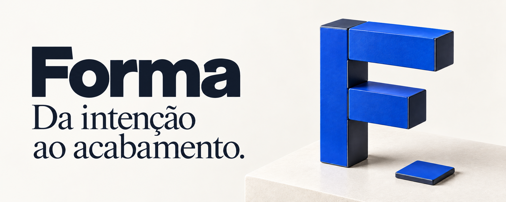

<p align="center">
  
</p>

# Forma

**Da intenção ao acabamento.**

Um sistema de design para assistentes de código: a Forma reúne uma coordenadora e 11 especialistas para criar, refinar e verificar interfaces, sistemas visuais e materiais de marca no seu projeto. Seleciona instruções e referências conforme o pedido, preservando sua identidade e sua stack. Disponível como plugin para **Codex**, **Claude Code** e como **Agent Skills** para outros ambientes compatíveis.

<p>
  <a href="#instalar">Instalar</a> ·
  <a href="#experimentar">Experimentar</a> ·
  <a href="#especialidades">Especialidades</a> ·
  <a href="#contribuir">Contribuir</a> ·
  <a href="#licenca">Licença</a>
</p>

## Experimentar

Descreva o resultado, o contexto e o que deve ser preservado. A coordenadora escolhe as especialidades pertinentes; você pode começar com um pedido como estes:

**Refinar uma interface**

> Use Forma para melhorar este formulário: hierarquia, espaçamento e estados de erro. Preserve a marca e os componentes existentes; teste as interações afetadas.

**Criar uma peça de marca**

> Use Forma para criar uma capa e uma apresentação curta deste produto. Use apenas os benefícios documentados e entregue os formatos editáveis solicitados.

**Auditar antes de mudar**

> Use Forma para revisar este fluxo no desktop e na largura mobile. Mostre os problemas reproduzíveis e as evidências; por enquanto, não edite.

No Codex, invoque **`$forma:forma`**; no Claude Code, **`/forma:forma`**. Nos demais ambientes, use o mecanismo de ativação oferecido pelo assistente.

## Especialidades

### Entender e direcionar

- [**Coordenadora**](source/forma/SKILL.md) — entende o pedido e seleciona as instruções pertinentes.
- [**Produto**](source/forma/skills/product/SKILL.md) — pesquisa, jornadas, organização e fluxos.
- [**Referências**](source/forma/skills/reference/SKILL.md) — análise de fontes, reprodução e fidelidade com evidências.

### Construir e refinar

- [**Fundações**](source/forma/skills/foundations/SKILL.md) · [**Interface**](source/forma/skills/interface/SKILL.md) — cor, tipografia, layout, componentes e estados.
- [**Objetos 3D**](source/forma/skills/objects-3d/SKILL.md) · [**Movimento**](source/forma/skills/motion/SKILL.md) — materiais, volumes, gestos, animações e filmes.
- [**Grafos e dados**](source/forma/skills/graphs-data/SKILL.md) · [**Plataformas**](source/forma/skills/platforms/SKILL.md) — visualizações e adaptação à web, mobile e desktop.

### Comunicar e entregar

- [**Marca**](source/forma/skills/brand/SKILL.md) — identidade, campanhas, apresentações e peças gráficas.
- [**Handoff**](source/forma/skills/handoff/SKILL.md) — artefatos editáveis, tokens, exportação e integração.
- [**Validação**](source/forma/skills/validation/SKILL.md) — acessibilidade, estados e qualidade com escopo verificável.

Explore também os [recursos reutilizáveis](source/forma/references/resources.md), os [cenários de avaliação](source/forma/evals/routing-scenarios.md) e o [histórico de versões](CHANGELOG.md).

## Instalar

Escolha **um formato por assistente**. Os pacotes estão prontos no repositório; não é necessário compilá-los para usar. Você também pode baixar tudo por **Code → Download ZIP** no GitHub.

<details open>
<summary><strong>Codex</strong> · plugin nativo</summary>

Com uma versão que ofereça `codex plugin`:

```sh
git clone https://github.com/figueirego/forma.git
cd forma
codex plugin marketplace add .
codex plugin add forma@forma-community
codex plugin list --marketplace forma-community --json
```

Mantenha o clone disponível: ele é a origem local do catálogo. Abra uma nova conversa ou faça o reload suportado e selecione **Forma**. Confira a origem: `forma-local`, `forma-community` e a skill avulsa são instalações independentes. Não edite o cache instalado.

Não são necessários Node, Python ou chaves de API para registrar o pacote pronto. O Codex e integrações opcionais têm seus próprios requisitos e condições.

</details>

<details>
<summary><strong>Claude Code</strong> · plugin nativo</summary>

```sh
claude plugin marketplace add figueirego/forma
claude plugin install forma@forma-community
claude plugin list
```

Inicie uma nova sessão e use `/forma:forma` seguido do pedido. Para testar um clone antes de instalar, execute `claude --plugin-dir ./plugins/forma-claude` na raiz deste repositório. Estas instruções se referem ao **Claude Code**, não a qualquer superfície de chat Claude.

</details>

<details>
<summary><strong>Cursor, Copilot, OpenCode e Gemini CLI</strong> · Agent Skills</summary>

Na raiz do clone ou ZIP extraído, substitua o caminho pelo seu projeto. O primeiro comando simula; o segundo aplica:

```sh
python3 tools/install_skills.py --destination /caminho/do/projeto/.agents/skills
python3 tools/install_skills.py --destination /caminho/do/projeto/.agents/skills --apply
```

O instalador exige Python 3.12+, preserva outras skills e recusa conflitos sem sobrescrever arquivos. No Windows, use `py -3` em vez de `python3` e coloque o caminho local entre aspas.

Sem Python, copie **as 12 pastas** de `distributions/agent-skills/` para a pasta de skills reconhecida pelo seu assistente. Elas compartilham recursos: não copie apenas o `SKILL.md`. Depois, faça o reload suportado pelo ambiente.

</details>

Consulte o [guia de instalação](docs/INSTALLATION.md) para atualização, remoção e evidências por ambiente. **Compatibilidade de formato não garante as mesmas ferramentas, permissões ou comportamento em todos os assistentes.**

## Escopo e limites

A Forma fornece instruções, referências e recursos locais; não é um editor visual independente. Integrações como navegador, Figma ou REA dependem do ambiente e não são conectadas automaticamente.

Testes de estrutura e geometria não comprovam renderização; uma viewport mobile não equivale a um aparelho físico. Há recursos executáveis e especificações para implementação, como o editor de aparência: nem toda capacidade descrita é um componente pronto para importar. Veja [operação e limites](source/forma/references/plugin-operation.md).

## Contribuir

Faça um fork, crie uma branch e abra um PR. Documentação, bugs reproduzíveis, exemplos, acessibilidade e testes são bem-vindos. Leia o [guia de contribuição](CONTRIBUTING.md).

Para alterar as skills, edite `source/forma/`, regenere as distribuições e verifique com **Python 3.12+ e Node 24+**:

```sh
npm ci --ignore-scripts
python3 tools/build.py
npm run check
```

Plugins, catálogos e Agent Skills são gerados e versionados; a CI verifica sua correspondência com a fonte. As mudanças passam por PR e revisão do mantenedor. Consulte as [regras de governança](docs/GOVERNANCE.md), incluindo a exceção do único mantenedor e os limites das proteções remotas, e a [política de segurança](SECURITY.md).

<a id="licenca"></a>

## Licença

[MIT](LICENSE). O ECC informou parte do método de organização; a Forma é independente e não instala ECC ou LangChain. Consulte a [procedência e os avisos de terceiros](source/forma/THIRD_PARTY_NOTICES.md). Referências externas mantêm seus próprios direitos e licenças.
